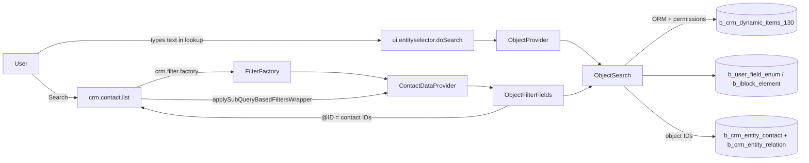

<!-- last-synced: 2026-10-15, commit: 301d031 -->
# Architecture — aldagi.objectfilter

## Components
| Component | File | Responsibility |
|---|---|---|
| `init.php` | `local/php_interface/init.php` | includes the module before crm |
| Module include | `local/modules/aldagi.objectfilter/include.php` | registers `crm.filter.factory` in ServiceLocator |
| `FilterFactory` | `lib/filter/filterfactory.php` | returns the custom `ContactDataProvider` for contact list filters |
| `ContactDataProvider` | `lib/filter/contactdataprovider.php` | delegates fields and the filter hook to `ContactLookupFilter` |
| `ContactLookupFilter` | `lib/filter/contactlookupfilter.php` | fields `PARENT_ID_130`, `ALDAGI_DEAL`, `ALDAGI_CALCULATION`; chains conditions through the object (D-7) → `@ID` |
| `ObjectFilterFields` | `lib/filter/objectfilterfields.php` | object lookup + `OBJ130_*` → readable object IDs |
| `LookupHelper` | `lib/filter/lookuphelper.php` | lookup field/dialog options, value parsing, `@ID` restriction |
| `LookupSearch` / `FactorySearch` | `lib/search/` | lookup contract; text search (`%=`), chip grouping, permissions for one CRM type |
| `ObjectSearch`, `DealSearch`, `CalculationTypeSearch`, `CalculationSearch` | `lib/search/` | per-entity links to contacts and dropdown display data; deals use full-text `SEARCH_CONTENT` |
| `LookupProvider` + Object/Deal/Calculation providers | `lib/entityselector/` | entity-selectors `aldagi-object`, `aldagi-deal`, `aldagi-calculation` |
| `.settings.php` | module root | registers the three providers in `ui.entity-selector` |

## Data flow

| Step | From → to | Data |
|---|---|---|
| 1 | lookup → `ObjectProvider::doSearch` | text → `search:<text>` + ≤50 objects |
| 2 | filter save | `PARENT_ID_130` array in `b_user_option` |
| 3 | list load → `applyActivityFastSearchFilter` | UI filter → object ORM filter |
| 4 | `ObjectSearch::getReadableObjectIds` | readable object IDs |
| 5 | `ObjectSearch::getContactIds` | contact IDs → `@ID` → `CCrmContact::GetListEx` |

## Extension points
- ServiceLocator service `crm.filter.factory` (core `Bitrix\Crm\Filter\Factory`)
- `Bitrix\Crm\Filter\ContactDataProvider::prepareFields / prepareFieldData / applyActivityFastSearchFilter`
- `Bitrix\UI\EntitySelector\BaseProvider` (`isAvailable`, `getItems`, `getSelectedItems`, `fillDialog`, `doSearch`)
- No core files modified
